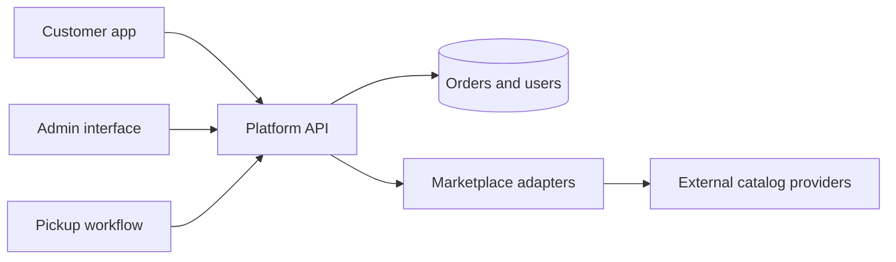
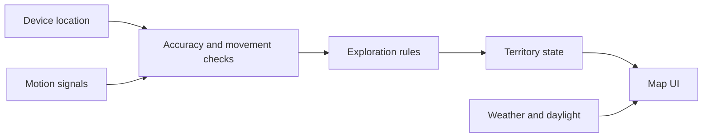
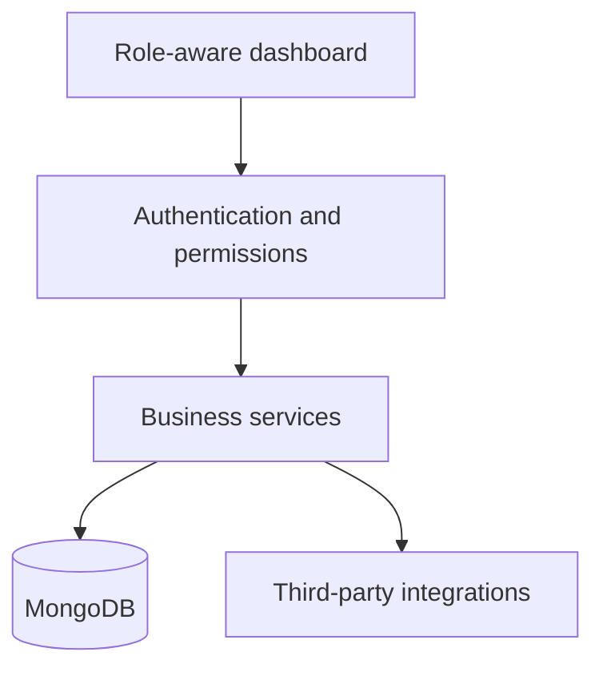
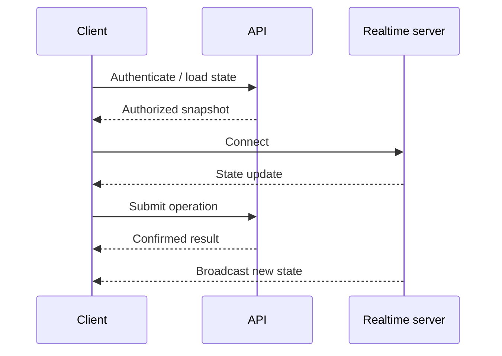

# Engineering Case Studies

> Selected engineering work and projects in development. These are technical summaries, not claims of independently verified production metrics. Customer data and private source code are intentionally excluded.

[← Back to profile](https://github.com/paradigmajs)

---

## 01 / Cargo & Cross-Border Commerce Platform

**Category:** Commerce, logistics, marketplace integration  
**Stack:** React, TypeScript, Node.js, Express, MongoDB, mobile application ecosystem  
**Status:** Active development; public release status not claimed

### Problem
Combine order placement, marketplace catalog interactions, cargo logistics and operational workflows into a connected product ecosystem with distinct experiences for customers and administrators.

### Product surface
- Customer-facing ordering and package tracking flows
- Admin operations, order and status management
- Collection-point workflow as part of the wider platform
- Marketplace integrations and provider-specific data normalization

### Engineering decisions
1. Keep marketplace adapters behind stable contracts. External providers change formats and behavior.
2. Model order statuses explicitly, rather than scattering string comparisons across UI components.
3. Separate price calculations, cross-border delivery costs and payment responsibility.
4. Keep sensitive integration keys on the backend and out of client bundles.

**What this illustrates:** architecture, integration boundaries and product thinking. Not an assertion that every module above is live in production.

---

## 02 / Tourisk · Location-Aware Exploration

**Category:** Mapping, mobile, location services  
**Stack:** React Native, mapping SDK, GPS, background location, server APIs  
**Status:** Mobile product under iteration

### Problem
Turn movement and geographical exploration into a consistent interactive experience across devices and changing location conditions.

### Engineering challenges
- GPS drift, stale coordinates and route discontinuities
- Movement classification, step-based vs location-based calculation
- Geographic cell unlock logic and map rendering
- Foreground/background application behavior and OS permissions
- Weather and day/night presentation without compromising map usability

### Engineering approach
Treat raw location samples as noisy measurements. Separate sensor ingestion from movement eligibility and territory-unlock rules. Never treat an abrupt position jump as physical movement without validation.

**What this illustrates:** mobile systems, location accuracy and user-centered design. GPS error cannot be solved by UI changes alone.

---

## 03 / Custom CRM & Business Operations

**Category:** Enterprise, internal tooling  
**Stack:** React, TypeScript, Node.js, Express, MongoDB  
**Status:** Experience area; individual client implementations are not disclosed

### Problem
Translate operational business processes into reliable, role-aware tools.

### Engineering scope
- Role and permission models
- Admin dashboards and editable workflows
- Business data validation and auditability
- Integration with external services
- Deployment, API security and maintenance considerations

**What this illustrates:** enterprise architecture and custom business software. No unverified revenue or performance claims.

---

## 04 / Real-Time Interactive Systems

**Category:** WebSocket applications and automation  
**Stack:** React, TypeScript, Node.js, Express, WebSocket  
**Status:** Engineering experience and prototypes

### Engineering challenges
- Server-authoritative state
- Real-time event ordering and reconnection
- Idempotency for sensitive operations
- UI synchronization and recovery from disconnected sessions
- Clean separation between transport events and domain state

**What this illustrates:** real-time system design patterns, not a claim about any named client's production architecture.

---

## Working principles

- **Security:** credential handling on the server, role enforcement and input validation.
- **Reliability:** clear error states, reconciliation and idempotent operations.
- **Maintainability:** typed contracts, boundary-driven design, readable code.
- **Product thinking:** work from user and business outcomes, not a list of framework names.
- **Responsible presentation:** no fictional testimonials, screenshots or performance statistics.

## Public GitHub vs client work

Some public repositories are experiments, forks or learning resources. They are **not proof of authorship of third-party software**. Commercial work is often private. For verified demonstrations, see the repositories with available source code and their histories.

[Explore repositories](https://github.com/paradigmajs?tab=repositories) · [Contact on Instagram](https://www.instagram.com/paradigma_dev/)
