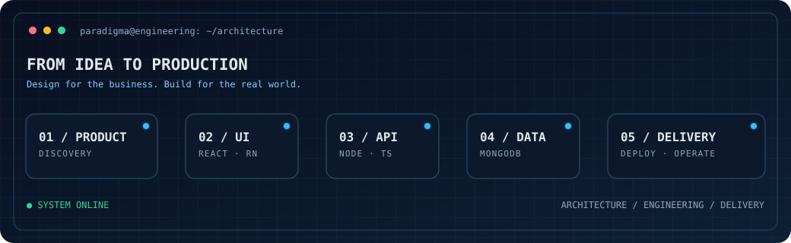

---

### `01 // ENGINEER BEHIND THE SYSTEMS`

# I build products that survive reality.

**Senior Fullstack Engineer · System Architect · 9 years of experience · Kyrgyzstan**

I translate complicated business rules into clear architecture and production-focused software. Not only screens. The entire system: **product thinking → engineering decisions → implementation → delivery**.

| Product engineering | Architecture | Delivery |
| :-- | :-- | :-- |
| Web platforms & mobile apps | APIs, data models & integrations | Deployment & iteration |
| CRM & internal tools | Real-time systems & workflows | Performance & maintainability |
| Marketplace & logistics systems | Roles, access & business logic | Product lifecycle ownership |

### `02 // TECHNICAL ARSENAL`

<b>Explore the stack by responsibility</b>

| Focus | Technologies | Engineering responsibility |
| :-- | :-- | :-- |
| Web applications | React, TypeScript, Vite, Redux Toolkit | Frontend architecture, complex flows, state |
| Mobile | React Native | Cross-platform experiences, device APIs |
| Services & APIs | Node.js, Express, Python, Django | Business rules, API contracts and integrations |
| Data | MongoDB, PostgreSQL | Modeling, queries, persistence |
| Delivery | Docker, Git | Environments, releases and maintainability |

### `03 // SELECTED ENGINEERING WORK`

**Click to expand each area.** These are actual types of work and current projects, not invented performance metrics or client testimonials.

<b>01 · Tourisk | Geospatial mobile exploration</b> <code>React Native · GPS · Maps</code>

Mobile experience built around movement, exploration, dynamic maps, route consistency and device location. Engineering challenges include GPS noise, movement validation, background execution, changing weather and daylight.

**Architecture principle:** sensor signals are evidence, not truth. Verify movement before applying exploration rules.

[View technical case study](CASE_STUDIES.md#02--tourisk--location-aware-exploration)

<b>02 · Cargo & cross-border commerce</b> <code>React · TypeScript · Node.js · MongoDB</code>

Connected product ecosystem for marketplace discovery, orders, shipping status and operational interfaces. Integration reliability matters when multiple external platforms speak different languages, literally and technically.

**Architecture principle:** keep external API adapters independent from pricing, customer orders and internal fulfillment states.

[View technical case study](CASE_STUDIES.md#01--cargo--cross-border-commerce-platform)

<b>03 · CRM & business automation</b> <code>System design · APIs · Data</code>

Role-based operational dashboards, business workflows, reporting, internal tools and integrations tailored to real company processes.

**Architecture principle:** build the domain model around how people work, not around what the UI mockup happens to show.

[View technical case study](CASE_STUDIES.md#03--custom-crm--business-operations)

<b>04 · Real-time & interactive products</b> <code>WebSocket · Events · React</code>

Live state synchronization, interactive experiences and automation where reconnection, ordering and idempotency matter.

**Architecture principle:** authoritative server state, explicit events, safe retries.

[View technical case study](CASE_STUDIES.md#04--real-time-interactive-systems)

### `04 // ENGINEERING PROCESS`

<b>What happens before the first commit?</b>

Requirements, constraints, user roles, integration boundaries, security expectations, and a plan that can actually be maintained. A polished component is not a substitute for knowing what the software should do.

<b>How do I handle complex integrations?</b>

Provider adapters, typed contracts, explicit error states, retry strategies and separation of external provider quirks from core business logic.

<b>What matters at release?</b>

Correctness, observability, access control, deployments, regression testing, performance and how the system behaves when external services fail.

### `05 // GITHUB TELEMETRY`

Language percentages describe repository code, not developer proficiency. GitHub widgets may temporarily rate-limit or fail; private work is not fully reflected.

### Contribution snake

<picture>
<source media="(prefers-color-scheme:dark)" srcset="https://raw.githubusercontent.com/paradigmajs/paradigmajs/output/github-snake-dark.svg"/>
<source media="(prefers-color-scheme:light)" srcset="https://raw.githubusercontent.com/paradigmajs/paradigmajs/output/github-snake.svg"/>

</picture>

### `06 // LET'S BUILD SOMETHING MEANINGFUL`

For businesses: **end-to-end product delivery, mobile platforms, CRM, marketplace and API integrations.**

For engineering teams: **architecture, complex implementation, debugging and refactoring.**

  

**GOOD SOFTWARE IS AN ENGINEERING DECISION.**

